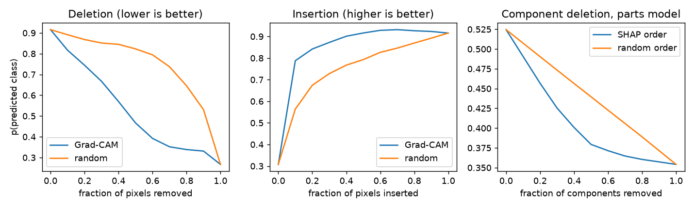
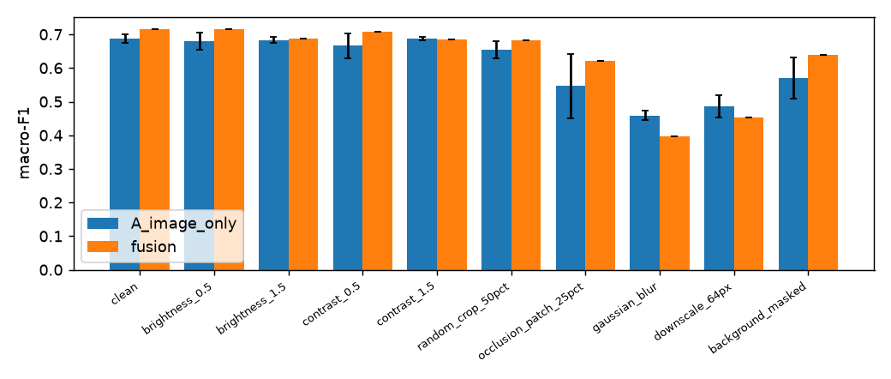

# Results (generated by `make report` from experiments/results/ and artifacts/; do not edit)

## Dataset

label_mode=RULE_BASED; temples considered=1607; labelled=368

Label status: {"NO_EVIDENCE": 1061, "LABELLED": 368, "EXCLUDED_OUT_OF_TAXONOMY": 165, "EXCLUDED_CONFLICT": 13}

| split | Deccan_Vesara | Dravida | Nagara | temples | images (all types) |
|---|---|---|---|---|---|
| train | 19 | 190 | 45 | 254 | 6592 |
| val | 4 | 41 | 9 | 54 | 1276 |
| test | 4 | 41 | 9 | 54 | 1094 |

Image types: {"exterior_partial": 4026, "exterior_full": 3771, "interior": 729, "detail": 436}

Licences: {"CC BY-SA": 7172, "CC0": 809, "CC BY": 744, "Public domain": 237}

## Ablation A–D (test split, mean ± std over seeds)

A image CNN; B +component features (zero-shot boxes); C +knowledge-prior features; D +evidence-alignment loss. P4 rows: heads trained on cached frozen features (`cnn_only`, `fusion` = CNN ⊕ distilled-YOLO component vector, `parts_*` = components only).

| variant | backbone / head | seeds | accuracy | macro-F1 |
|---|---|---|---|---|
| A | efficientnet_b0 | 3 | 0.814 ± 0.003 | 0.688 ± 0.013 |
| A | mobilenetv3_large_100 | 3 | 0.812 ± 0.013 | 0.697 ± 0.016 |
| B | efficientnet_b0 | 3 | 0.815 ± 0.015 | 0.682 ± 0.024 |
| C | efficientnet_b0 | 3 | 0.824 ± 0.019 | 0.711 ± 0.018 |
| D | efficientnet_b0 | 3 | 0.822 ± 0.017 | 0.694 ± 0.027 |
| P4 | cnn_only | 3 | 0.844 ± 0.003 | 0.716 ± 0.008 |
| P4 | fusion | 3 | 0.830 ± 0.006 | 0.714 ± 0.002 |
| P4 | parts_gb | 3 | 0.541 ± 0.003 | 0.450 ± 0.001 |
| P4 | parts_mlp | 3 | 0.548 ± 0.018 | 0.386 ± 0.004 |

## P4 fusion and part-based models

| model (frozen-feature heads, 3 seeds) | accuracy | macro-F1 |
|---|---|---|
| CNN features only | 0.844 ± 0.003 | 0.716 ± 0.008 |
| CNN ⊕ component vector (serving model) | 0.830 ± 0.006 | 0.714 ± 0.002 |
| components only, gradient boosting | 0.541 ± 0.003 | 0.450 ± 0.001 |
| components only, MLP | 0.548 ± 0.018 | 0.386 ± 0.004 |
| reference: A fine-tuned end-to-end (J2, selected seed) | 0.817 | 0.702 |

McNemar (exact), CNN-only vs fusion: CNN-only right/fusion wrong = 49, fusion right/CNN-only wrong = 30, p = 0.042. Fine-tuned A vs fusion: 20 / 29, p = 0.253. Image-level tests; images of one temple are correlated, so p-values are optimistic.

## J3 distilled component detector (YOLO)

detector_mode=DISTILLED; gold_eval=UNAVAILABLE; compute=local_mps

Agreement with zero-shot boxes on val temples: mAP50=0.392, mAP50-95=0.302, P=0.414, R=0.452. This is agreement with pseudo-labels, not accuracy; detector mAP vs. gold boxes is available with the gold-set add-on.

## Explanation evaluation

Numbers below are copied from `summary.json`; intervals are 95 % temple-bootstrap CIs. All metrics are ground-truth-free.

## Faithfulness of Grad-CAM (image branch)

- Deletion AUC (lower = better): Grad-CAM 0.527 [0.496, 0.556] vs random 0.758 [0.730, 0.784]; Grad-CAM lower in 91% of images.
- Insertion AUC (higher = better): Grad-CAM 0.864 [0.841, 0.887] vs random 0.757 [0.717, 0.793]; Grad-CAM higher in 84% of images.

## Component-occlusion sensitivity

- Mean drop in p(predicted class) when a detected component box is greyed out: 0.220 [0.187, 0.255]; equal-area random box: 0.201 [0.170, 0.232].
- Paired difference (component - random): 0.019 [0.006, 0.036]; component larger in 43% of pairs.
- Per component x tradition: `occlusion_by_component_x_tradition.csv`.

## SHAP - knowledge-graph alignment (components-only model)

- Top-SHAP component is cited as evidence for the predicted tradition: 0.771 [0.729, 0.809] vs random-component chance 0.728 [0.702, 0.755] (620 images).
- Component-deletion AUC by SHAP order 0.405 vs random order 0.440 (lower = SHAP order more faithful).

## Grad-CAM / detector agreement (not correctness)

- CAM peak inside any detected component box: 0.768 [0.717, 0.819] (box area share, i.e. chance: 0.617 [0.556, 0.672]).
- CAM peak inside a box of a component linked to the predicted tradition: 0.804 [0.744, 0.854] (chance: 0.616 [0.554, 0.669]).
- Share of CAM energy inside detected boxes: 0.706 [0.651, 0.755] (area share: 0.617 [0.558, 0.672]).

## Gold-based metrics

available with the gold-set add-on (HUMAN_ADDONS.md): pointing game, energy pointing, explanation IoU, detector mAP vs gold boxes

## Robustness

A_image_only: EfficientNet-B0, mean ± std over 3 seeds. fusion: serving model (detector re-run on each perturbed image). `background_masked` keeps only images with ≥1 detection (n shown).

| condition | model | n | accuracy | macro-F1 |
|---|---|---|---|---|
| background_masked | A_image_only | 802 | 0.676 ± 0.075 | 0.570 ± 0.062 |
| background_masked | fusion | 802 | 0.751 | 0.639 |
| brightness_0.5 | A_image_only | 940 | 0.814 ± 0.012 | 0.680 ± 0.025 |
| brightness_0.5 | fusion | 940 | 0.831 | 0.714 |
| brightness_1.5 | A_image_only | 940 | 0.809 ± 0.009 | 0.682 ± 0.009 |
| brightness_1.5 | fusion | 940 | 0.804 | 0.686 |
| clean | A_image_only | 940 | 0.814 ± 0.003 | 0.688 ± 0.013 |
| clean | fusion | 940 | 0.827 | 0.717 |
| contrast_0.5 | A_image_only | 940 | 0.799 ± 0.030 | 0.666 ± 0.037 |
| contrast_0.5 | fusion | 940 | 0.829 | 0.707 |
| contrast_1.5 | A_image_only | 940 | 0.811 ± 0.003 | 0.687 ± 0.005 |
| contrast_1.5 | fusion | 940 | 0.801 | 0.685 |
| downscale_64px | A_image_only | 940 | 0.756 ± 0.043 | 0.487 ± 0.033 |
| downscale_64px | fusion | 940 | 0.793 | 0.452 |
| gaussian_blur | A_image_only | 940 | 0.715 ± 0.065 | 0.459 ± 0.014 |
| gaussian_blur | fusion | 940 | 0.777 | 0.396 |
| occlusion_patch_25pct | A_image_only | 940 | 0.685 ± 0.103 | 0.546 ± 0.095 |
| occlusion_patch_25pct | fusion | 940 | 0.776 | 0.620 |
| random_crop_50pct | A_image_only | 940 | 0.779 ± 0.018 | 0.654 ± 0.027 |
| random_crop_50pct | fusion | 940 | 0.803 | 0.683 |

